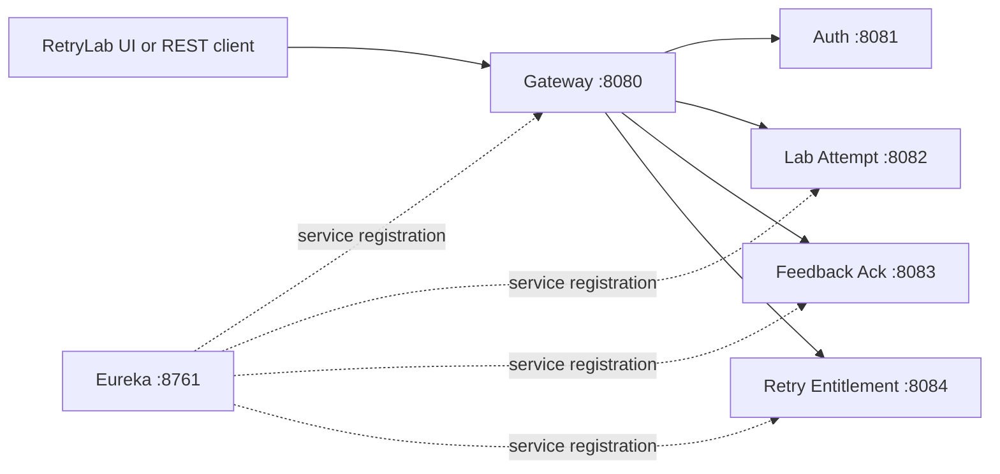

# Laboratory Retry Entitlement — Team 9

**Challenge:** Section 9, Team 9 — Laboratory Retry Entitlement  
**Course:** SOA Programming and Microservices (24SDCS03)  
**Status:** Runnable demonstration implementation with automated business-rule tests.

## Core rule
A learner may retry a failed lab only after feedback acknowledgement and within the retry allowance. Reserving then cancelling a retry before start must preserve the token. A token is consumed only when the retry starts.

## Stack
Java 21, Maven, Spring Boot 3.4.5, Spring Cloud 2024.0.1, Eureka, Gateway, Kafka and H2 (temporary in-memory demo state).

## Run
Prerequisites: JDK 21, Maven 3.9+, Docker Compose.

1. Start Kafka: `docker compose up -d`
2. Build: `mvn clean package`
3. In separate terminals:
   - `mvn -pl discovery-service spring-boot:run`
   - `mvn -pl auth-service spring-boot:run`
   - `mvn -pl gateway-service spring-boot:run`
   - `mvn -pl lab-attempt-service spring-boot:run`
   - `mvn -pl feedback-ack-service spring-boot:run`
   - `mvn -pl retry-entitlement-service spring-boot:run`

Ports: Gateway 8080, Auth 8081, LabAttempt 8082, FeedbackAck 8083, RetryEntitlement 8084, Eureka 8761, Kafka 9092.

## Basic demo endpoints
Seed two tokens:
`POST http://localhost:8080/entitlements/learner1/seed?tokens=2`

Reserve then cancel before start:
`POST http://localhost:8080/entitlements/learner1/reserve?attemptId=attempt-1`
`POST http://localhost:8080/entitlements/learner1/cancel?attemptId=attempt-1`
Check token state:
`GET http://localhost:8080/entitlements/learner1`

The token count should remain 2. Starting a reserved retry via `POST /entitlements/learner1/start?attemptId=attempt-1` consumes one token.

## Implemented behavior and limits
The domain controllers now validate required identifiers, expose attempt history and
feedback status, reject invalid transitions, make reservations idempotent for the
same attempt, and synchronize token allocation per learner. The gateway has an
explicit local-development CORS policy. The frontend is a real Vite/React client
using gateway APIs; it does not fabricate metrics.

The services still use process-local maps for the demonstration, so state resets on
restart and two-instance consistency is not provided. Kafka dependencies and H2
configuration are present, but event producers/consumers and JPA repositories are
not wired into the business path. The auth endpoint remains a status scaffold:
signed JWT issuance/validation, Spring Security roles, TLS, audit redaction, DLQ
processing, and CI/load evidence are not implemented and must not be claimed.

## CO evidence
- CO1: Six service module scaffolds and basic REST endpoints; complete REST contracts/Kafka workflow remain planned.
- CO2: Not implemented yet.
- CO3: Eureka and Gateway scaffolds are present; verify registration/routing. Persistent per-service JPA databases and failover remain planned.
- CO4: Entitlement unit tests and reactor/frontend builds are verified; contract tests,
  load test and GitHub Actions remain planned.

See `docs/co-mapping.md` and `docs/review-checklist.md`.

## Verified local workflow

The controller arguments are explicitly named and the root Maven compiler configuration
also emits Java parameter metadata. This is required by Spring MVC when compiled classes
are used without debug parameter names; without it, even the seed endpoint returned 500
with `Name for argument ... not specified`.

From the repository root, run the entitlement service on an unused port for a focused
check:

```powershell
mvn -pl retry-entitlement-service spring-boot:run "-Dspring-boot.run.arguments=--server.port=18084"
```

In another PowerShell terminal:

```powershell
curl.exe -X POST "http://localhost:18084/entitlements/learner1/seed?tokens=2"
curl.exe -X POST "http://localhost:18084/entitlements/learner1/reserve?attemptId=attempt-1"
curl.exe -X POST "http://localhost:18084/entitlements/learner1/cancel?attemptId=attempt-1"
curl.exe "http://localhost:18084/entitlements/learner1"
curl.exe -X POST "http://localhost:18084/entitlements/learner1/reserve?attemptId=attempt-1"
curl.exe -X POST "http://localhost:18084/entitlements/learner1/start?attemptId=attempt-1"
```

The first read returns `tokens: 2`, and the read after `start` returns `tokens: 1`.
The focused entitlement business tests are run with:

```powershell
mvn -pl retry-entitlement-service test
```

## Architecture



## API summary

| Service | Endpoint | Purpose |
|---|---|---|
| Retry entitlement | `POST /entitlements/{learnerId}/seed?tokens=N` | Seed demo allowance |
| Retry entitlement | `POST /entitlements/{learnerId}/reserve?attemptId=...` | Reserve one retry |
| Retry entitlement | `POST /entitlements/{learnerId}/cancel?attemptId=...` | Release reservation without consuming |
| Retry entitlement | `POST /entitlements/{learnerId}/start?attemptId=...` | Consume the reserved retry |
| Retry entitlement | `GET /entitlements/{learnerId}` | Read current allowance |
| Feedback | `POST /feedback?learnerId=...&attemptId=...&text=...` | Record feedback |
| Feedback | `POST /feedback/{id}/acknowledge?learnerId=...` | Acknowledge feedback |
| Lab attempt | `POST /attempts?learnerId=...&labId=...` | Record a failed attempt |

## Current limitations

The verified fix and entitlement tests do not imply that the scaffold has durable
persistence, JWT authorization, Kafka event consumers, a frontend, or multi-instance
failover. Those remain explicit follow-up work documented in `docs/co-mapping.md`;
the current in-memory state is reset whenever its service restarts.

## RetryLab frontend

The frontend lives in `frontend/` and is intentionally separate from the Maven
reactor. From that directory:

```powershell
npm install
npm run dev
```

Open `http://localhost:5173`. It calls `http://localhost:8080` by default. To use
another gateway URL, set `VITE_API_URL` before starting Vite:

```powershell
$env:VITE_API_URL = "http://localhost:8080"
npm run dev
```

The dashboard supports recording an attempt, issuing and acknowledging feedback,
reserving/cancelling a retry, and starting a reserved retry. Controls remain
disabled until their prerequisite state is available.

The frontend signs in through `/auth/login` and sends the JWT on gateway requests.
Learner sessions load and acknowledge instructor-issued feedback; instructor
sessions can issue feedback. If gateway calls fail with 500 after changing network
interfaces, restart all services so Eureka refreshes the loopback registrations.

See [runtime-validation-report.md](./runtime-validation-report.md) for the latest
build, startup, API workflow, and browser validation evidence.

## Demo sequence

1. Start the discovery and four domain/gateway services using the commands above.
2. Seed a learner through the gateway:
   `curl.exe -X POST "http://localhost:8080/entitlements/learner1/seed?tokens=2"`.
3. Start the frontend and record an attempt.
4. Issue feedback for that attempt and acknowledge it.
5. Reserve, cancel, reserve again, and start the retry. Confirm that cancellation
   leaves `tokens` unchanged and start decrements it once.
6. To reset demonstration state, restart the affected service; this is a reset of
   process-local demo state, not a production data reset.
# soa-hackathon
