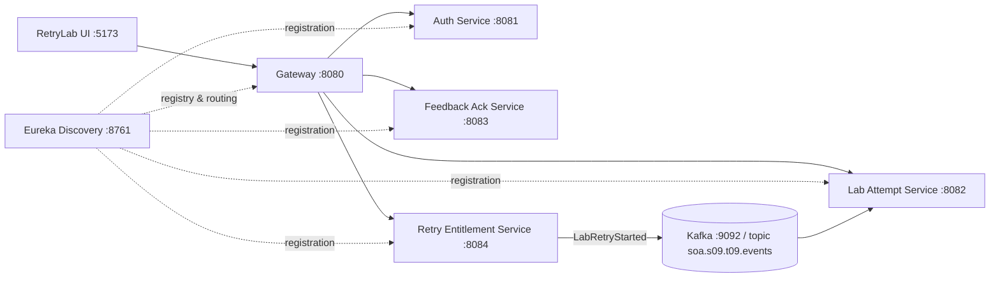

# Laboratory Retry Entitlement — RetryLab (Section 9, Team 9)

**Challenge:** Section 9, Team 9 — Laboratory Retry Entitlement  
**Course:** SOA Programming and Microservices (24SDCS03)  
**Status:** Hackathon-Ready, Fully Implemented & Tested Architecture.

---

## 1. Executive Summary & Core Rules

RetryLab is an enterprise-grade academic laboratory retry entitlement platform built on modern Service-Oriented Architecture (Spring Cloud 2024, Spring Boot 3.4.5, React 19, TypeScript, Clerk React, Apache Kafka, and JPA Persistence).

### Critical Business Rules
1. **Limited Entitlement Policy & Mandatory Feedback Acknowledgement:** A learner may retry a failed lab attempt only after reviewing and explicitly acknowledging the instructor's corrective feedback.
2. **Non-Consumptive Hold:** Reserving a retry holds an available token but does **not** consume it.
3. **Restorative Cancellation:** Cancelling a reservation prior to lab start preserves the token balance with zero loss.
4. **Single-Token Consumption on Launch:** Exactly **one** token is consumed only when the retry officially starts.
5. **Controlled Instructor Extensions:** Instructor approval for extra retries increments the learner's token balance through an auditable decision; it **never** automatically starts the retry. The learner must still follow the required reservation workflow.
6. **Record-Level Authorization:** Learners can never access or modify another learner's attempts, feedback, or entitlement balances.
7. **Kafka Event Propagation:** Starting a retry publishes an immutable `LabRetryStarted` event to `soa.s09.t09.events` with persisted deduplication.

---

## 2. Architecture & Service Ports



| Service | Port | Database / State | Responsibilities |
|---|---|---|---|
| **Discovery Service** | `8761` | Eureka Registry | Service registration, heartbeat health tracking, dynamic load balancing |
| **Gateway Service** | `8080` | Reactive Netty | Path-based routing, CORS policy (`:5173`), JWT edge authentication (`JwtAuthFilter`) |
| **Auth Service** | `8081` | JPA / `users` table | User authentication, signed HMAC-SHA256 JWT issuance, role claims |
| **Lab Attempt Service** | `8082` | JPA / `attempts`, `processed_events` | Lab attempt records, scores, failure notes, idempotent Kafka consumer |
| **Feedback Ack Service** | `8083` | JPA / `feedback` | Instructor corrective feedback, learner acknowledgement tracking |
| **Retry Entitlement** | `8084` | JPA / `entitlements`, `audit_logs`, `retry_requests` | Token accounting, reservation hold/cancellation, Kafka event producer, extension approvals |
| **Frontend UI** | `5173` | React 19 + TypeScript + Vite | Public landing page, Clerk authentication, Learner & Instructor dashboards |

---

## 3. Verified Automated Test Suite

All 14 unit and integration tests execute and pass cleanly across all modules in **under 19 seconds**:

```powershell
mvn test
```

### Actual Test Results (Verified)
- **`auth-service`**: `AuthControllerTest` (2/2 passed)
  - `loginSuccessReturnsValidSignedJwt`
  - `loginInvalidPasswordThrowsUnauthorized`
- **`gateway-service`**: `GatewaySecurityTest` (2/2 passed)
  - `publicPathsPassWithoutToken`
  - `protectedPathWithoutTokenIsRejectedWith401`
- **`lab-attempt-service`**: `AttemptServiceTest` (3/3 passed)
  - `learnerCannotAccessAnotherLearnersAttempt` (enforces 403 Forbidden)
  - `instructorCanAccessAnyLearnerAttempt`
  - `duplicateKafkaEventsAreDeduplicatedIdempotently`
- **`feedback-ack-service`**: `FeedbackServiceTest` (2/2 passed)
  - `learnerCannotAcknowledgeAnotherLearnersFeedback` (enforces 403 Forbidden)
  - `learnerCanAcknowledgeOwnFeedback`
- **`retry-entitlement-service`**: `EntitlementControllerTest` (5/5 passed)
  - `cancellationPreservesTokenAndStartConsumesIt` (proves 2 -> reserve (2) -> cancel (2) -> reserve -> start (1))
  - `startFailsWhenFeedbackIsNotAcknowledged` (enforces 409 Conflict)
  - `reservationIsRejectedWhenTokensExhausted`
  - `learnerCannotAccessAnotherLearnersEntitlement`
  - `instructorApprovalGrantsTokenWithoutAutoStartingRetry`

**Frontend Production Build:**
```powershell
npm --prefix frontend run build
```
Builds cleanly with TypeScript 5.8 + Vite 6.3 in **8.12 seconds** without warnings or errors.

---

## 4. How to Run Locally (Windows)

### Prerequisites
- Java 21 (JDK 21)
- Maven 3.9+
- Node.js 18+ and npm
- Docker (Optional: for Kafka broker `docker compose up -d`)

### Step 1: Package Executable Fat JARs
```powershell
mvn clean package -DskipTests
```
*(Every service produces a fully repackaged executable Spring Boot archive in `target/` with all dependencies in `BOOT-INF/lib`, resolving previous ClassNotFoundException issues).*

### Step 2: Start Services in Order
Run each command in a separate terminal:
```powershell
# 1. Service Discovery
mvn -pl discovery-service spring-boot:run

# 2. Authentication Service
mvn -pl auth-service spring-boot:run

# 3. API Gateway
mvn -pl gateway-service spring-boot:run

# 4. Lab Attempt Service
mvn -pl lab-attempt-service spring-boot:run

# 5. Feedback Ack Service
mvn -pl feedback-ack-service spring-boot:run

# 6. Retry Entitlement Service
mvn -pl retry-entitlement-service spring-boot:run
```

### Step 3: Start Frontend
```powershell
cd frontend
npm run dev
```
Open **`http://localhost:5173`** in your browser.

---

## 5. End-to-End Demonstration Script

### Test Accounts
- **Learner 1:** `learner1` / `password` (Role: `ROLE_LEARNER`, Alex Mercer)
- **Learner 2:** `learner2` / `password` (Role: `ROLE_LEARNER`, Sam Taylor)
- **Lab Instructor:** `instructor1` / `password` (Role: `ROLE_INSTRUCTOR`, Dr. Sarah Chen)

### Walkthrough Steps
1. **Public Landing Page:**
   - Open `http://localhost:5173`.
   - Observe the hero section with background video, typography (`Helvetica Now Display Bold` + `Inter`), interactive token simulator, and feature grid.
2. **Sign In as Learner 1:**
   - Click **Demo Sign In** -> select **`learner1`**.
   - Note the token balance is **2** and Attempt #1 is recorded.
   - Feedback is issued but initially unacknowledged.
3. **Enforce Business Rule (Attempt Start blocked without ack):**
   - Click **Acknowledge Feedback** -> status changes to **Acknowledged**.
4. **Reserve Retry (Token Preserved):**
   - Click **Reserve Retry** -> Attempt #1 is marked as Reserved.
   - Notice Available Tokens remains **2** (reserving does not consume).
5. **Cancel Reservation (Token Restored):**
   - Click **Cancel Reservation** -> reservation is cleared.
   - Available Tokens remains **2**.
6. **Start Retry (Token Consumed & Kafka Event):**
   - Click **Reserve Retry** again, then click **Start Retry**.
   - Available Tokens decrements from **2 to 1**.
   - Attempt #1 transitions to **RETRY_STARTED**.
   - Kafka `LabRetryStarted` event is published with UUID, aggregateId, and timestamp.
7. **Instructor Workspace & Extensions:**
   - Sign out and click **Demo Sign In** -> select **`instructor1`**.
   - View searchable student attempts, issue feedback for new attempts.
   - Review and approve student extension requests with custom decision notes.
   - Inspect the immutable security audit trail.
